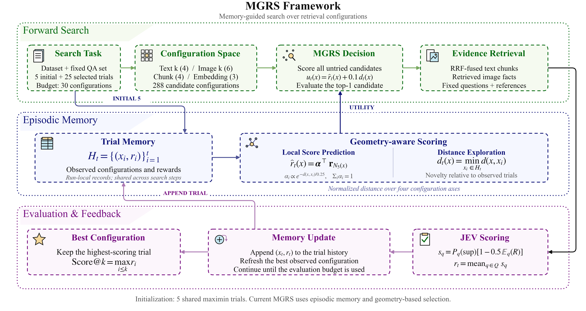
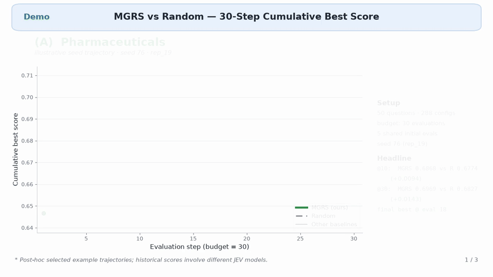
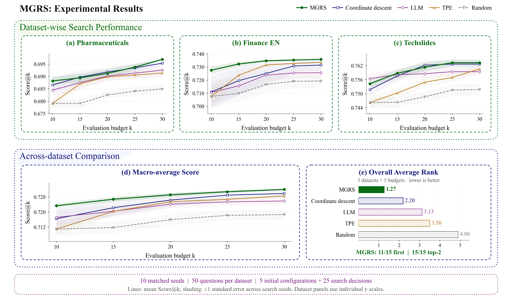

<h1 align="center">MGRS: Memory-Guided Retrieval Search</h1>

<p align="center">
  Budgeted configuration search for multimodal retrieval-augmented generation
</p>

<p align="center">
  <a href="#-overview">Overview</a> ·
  <a href="#-method">Method</a> ·
  <a href="#-demo">Demo</a> ·
  <a href="#-results">Results</a> ·
  <a href="#-getting-started">Getting started</a> ·
  <a href="#-reproducibility">Reproducibility</a>
</p>

<p align="center">
  
  
  
  <a href="LICENSE"></a>
</p>

## 💡 Overview

The best retrieval setup for a multimodal RAG system depends on its knowledge base. **MGRS** searches over text retrieval depth, image retrieval depth, chunk size, and embedding backend under a fixed evaluation budget. It evaluates each tried configuration on a small, fixed question set and uses the observed rewards to choose the next configuration. The final output is the highest-scoring configuration evaluated within the budget.

MGRS uses **Dual-Question Composite Reward (DQCR)** to assess whether retrieved evidence supports a reference answer and how much of that evidence repeats the same facts. The selector then combines a local reward estimate from its trial memory with a distance-based exploration bonus. It does not call an LLM to make search decisions; the judge and image transcription models are used during configuration evaluation.

## 🧭 Method

<p align="center">
  
</p>

Each configuration is a tuple of four choices:

| Component | Values |
| --- | --- |
| Text top-*k* | `5`, `10`, `20`, `40` |
| Image top-*k* | `0`, `1`, `3`, `5`, `10`, `20` |
| Chunk size | `64`, `128`, `256`, `512` |
| Embedding backend | `jina_nano`, `jina_small`, `qwen3_vl_2b` |

This gives **288 candidate configurations**. A search starts with five shared evaluations and makes 25 further selections. For an untried configuration, MGRS predicts reward from its five nearest evaluated configurations and adds `0.1 ×` its distance from the nearest observation. It evaluates the highest-utility candidate, records the new reward, and repeats until the 30-evaluation budget is used.

For a question *q*, DQCR combines the judge's support probability and expected semantic redundancy:

```text
reward(q) = P(support | q, evidence) × [1 − 0.5 × E(redundancy | q, evidence)]
configuration reward = mean reward(q) over the fixed question set
```

Images are transcribed into question-independent facts before judging. DQCR is an **evidence-level proxy reward**; it is not a recall metric or a direct measure of downstream answer accuracy.

## 🎬 Demo



*Illustrative trajectories selected after the runs; historical scores shown in this demo involve different JEV models. The complete 20-seed comparison below is the main quantitative result.* [Download the MP4](assets/mgrs_demo.mp4).

## 📈 Results

We compare MGRS with Random, coordinate descent, TPE, and an LLM controller on three document collections. Each dataset uses 50 fixed questions. Within each of 20 matched search seeds, the methods start from the same five configurations and receive the same budget. **Score@k** is the best DQCR reward observed in the first *k* evaluations, averaged across seeds.

| Dataset | MGRS @10 | Random @10 | MGRS @30 | Random @30 | Coordinate descent @30 | TPE @30 | LLM @30 |
| --- | ---: | ---: | ---: | ---: | ---: | ---: | ---: |
| Pharmaceuticals | **0.6881** | 0.6792 | **0.6969** | 0.6848 | 0.6950 | 0.6919 | 0.6886 |
| Finance EN | **0.7244** | 0.7074 | **0.7359** | 0.7203 | 0.7337 | 0.7326 | 0.7243 |
| Techslides | **0.7516** | 0.7473 | 0.7627 | 0.7532 | **0.7628** | 0.7601 | 0.7601 |

The table uses the complete **20-seed** experiment. MGRS has a higher mean Score@30 than Random in all three datasets; on Techslides, coordinate descent is marginally higher at @30. These are point estimates, not claims of a statistically significant difference. The [full experimental report](docs/20261104_three_dataset_rep20_report.md) includes all five budgets and the historical rule-augmented ablation.

<p align="center">
  
</p>

<p align="center"><em>Visualization of the first 10 seeds in the fixed 20-seed sequence. The 20-seed table above is the primary result.</em></p>

## 🔧 Getting started

### 1. Install

```bash
git clone https://github.com/chery-nextai/MGRS.git
cd MGRS
python3 -m venv .venv
source .venv/bin/activate
python -m pip install -r requirements.txt
cp .env.example .env
```

Fill in `.env` with the judge and model endpoints, credentials, corpus locations, Elasticsearch connection, and local embedding-model paths. The template documents each variable. The evaluation depends on these services and on the prepared indexes; the Python package alone is not sufficient to run a search.

### 2. Prepare data and indexes

The repository includes the **50-question evaluation subsets**, but not the underlying document text, images, model weights, or Elasticsearch indexes. Obtain each corpus under its original terms and arrange its pages and images as described in [the dataset notes below](#-data-and-indexes). Build or connect the 15 indexes for each dataset (12 text indexes across four chunk sizes and three backends, plus three image indexes).

```bash
bash scripts/run.sh --validate-only
```

To build indexes for a new corpus, see `python scripts/build_ao_dataset_index.py --help`.

### 3. Run MGRS

```bash
DATASET=techslides POLICIES=jit_no_rules SEEDS=20 STEPS=25 bash scripts/run.sh
```

`jit_no_rules` is the **current command-line identifier for the final MGRS method**. The published method name throughout this README is MGRS; the identifier is retained in the code and frozen experiment records for compatibility. The legacy `jit` policy adds rules and is treated as an ablation, not as MGRS.

Use `DATASET=pharmaceuticals` or `DATASET=finance_en` for the other collections. Leaving `POLICIES` empty runs all six implemented strategies. `SEEDS` controls the number of search repeats and `STEPS` the decisions after the initial five evaluations. `TEXT_TOPK`, `IMAGE_TOPK`, `CHUNKS`, and `BACKENDS` can narrow the search space; see [the frozen configuration](configs/definitive_runs.json) for the full protocol.

## 📂 Data and indexes

| Dataset | Document pages | Included evaluation subset |
| --- | ---: | --- |
| `pharmaceuticals` | 2,313 | [`qa_screened50_from_200.json`](datasets/ao_ready_v1_subsets/pharmaceuticals/qa_screened50_from_200.json) |
| `finance_en` | 2,942 | [`qa_screened50_from_179.json`](datasets/ao_ready_v1_subsets/finance_en/qa_screened50_from_179.json) |
| `techslides` | 1,963 | [`qa_screened50_from_200.json`](datasets/ao_ready_v1_subsets/techslides/qa_screened50_from_200.json) |

Each subset contains 50 questions with reference answers. The corpus reader expects a dataset directory containing `corpus.json` with page records such as `{id, text, images: [...]}` and the referenced image files. Set `MGRS_AO_CORPUS_ROOT` or a dataset-specific `MGRS_AO_CORPUS_DIR_*` variable in `.env`. Set `MGRS_INDEX_PREFIX_*` if your index names differ from the defaults. Corpus content remains subject to the source publishers' licenses.

## 🔁 Reproducibility

The [frozen experiment configuration](configs/definitive_runs.json) records the search space, reward parameters, model identifiers, seed protocol, datasets, and run IDs. The [result report](docs/20261104_three_dataset_rep20_report.md) records the 20-seed results. Historical files use `jit_no_rules` for MGRS and `jit` for the rule-augmented ablation.

```bash
# After the three frozen run directories have been restored under runs/:
OUT=/tmp/mgrs_report.md bash scripts/reproduce_report.sh
```

`reproduce_report.sh` recomputes the report from saved trajectories without model or Elasticsearch calls. **The required `runs/20261103_*` trajectory directories are not currently included in this repository**, so the offline command cannot run from a fresh clone until those artifacts are supplied or the experiments are rerun. `scripts/run_search.sh` contains the frozen rerun entry point; its `rep6` run-ID segment is historical naming, while the experiment contains 20 repeats.

For a faithful rerun, keep the judge model and `MGRS_JUDGE_SCHEMA_TAG` aligned with the frozen protocol. A different judge or reward setting defines a different scoring baseline; use a new schema tag and run ID rather than reusing old response caches. The frozen runs used `Jev_AO`, `qwen3.7-flash` image transcription, `qwen3.8-max` for the LLM baseline, and `γ = 0.5` in DQCR.

## 🗺️ Code map

```text
mgrs/
├── pipeline/             Search entry point, policies, run layout, and DQCR
├── memory/               Configuration and reward memory
├── controllers/          LLM, coordinate descent, and other baselines
├── rag_pipeline/         Text and image retrieval, encoding, and model clients
├── analysis/             Frozen-run analysis and report generation
└── judge_client.py       Judge API adapters and response validation
scripts/
├── run.sh                General experiment entry point
├── run_search.sh         Frozen-protocol rerun entry point
├── build_ao_dataset_index.py
└── reproduce_report.sh Offline report generation from saved runs
configs/definitive_runs.json
datasets/ao_ready_v1_subsets/
docs/20261104_three_dataset_rep20_report.md
```

## 📜 License

This repository is released under the [MIT License](LICENSE). Dataset and model licenses are governed by their respective publishers.
